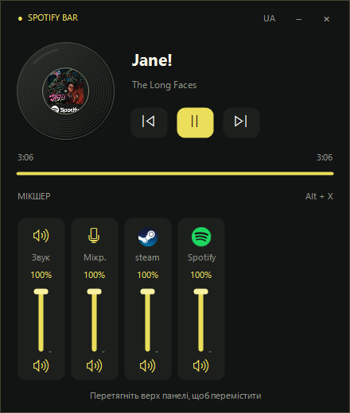

# Spotify Bar

Компактна панель Spotify / SoundCloud та мікшер звуку для Windows, написані на C# / Windows Forms. Працює без Python і сторонніх пакетів.



## Можливості

- Керування відтворенням Spotify та SoundCloud через Windows: попередній трек, пауза, наступний трек.
- Назва, виконавець і час відтворення з Windows Media API.
- Плавний локальний відлік часу зі звірянням зі Spotify.
- Анімована вінілова платівка з обкладинкою або жовтою етикеткою.
- Загальна гучність, мікрофон та окремі аудіосесії програм.
- Українська та англійська мови інтерфейсу.
- Глобальна комбінація **Alt+X**, системний трей, панель поверх інших вікон.

## Вимоги

Windows 10 (1809+) або Windows 11, x64, .NET Framework 4.8. Для даних треку потрібна системна медіасесія Spotify або браузера із SoundCloud.

## Збирання

Встановіть **.NET Framework 4.8 Developer Pack**. Скрипт використовує системний компілятор C# і метадані Windows; NuGet та Python не потрібні.

У PowerShell виконайте з папки проєкту:

```powershell
powershell -NoProfile -ExecutionPolicy Bypass -File .\build.ps1 -Test
```

Готова програма: `dist/SpotifyBar.exe`. Скрипт також працює з іншої поточної папки. Перед повторним збиранням закрийте запущений файл із `dist`.

## Керування

### SoundCloud

Відкрийте SoundCloud у Chrome, Edge, Firefox або іншому підтримуваному браузері та почніть відтворення. Панель читає системну медіасесію Windows. У режимі Auto пріоритет має активна сесія, яка грає; Spotify також залишається доступним.

Для фіксації джерела: правою кнопкою на значку в треї → **Джерело / Player → SoundCloud (browser)**. Пункти **Auto** та **Spotify** повертають автоматичний вибір або фіксують Spotify.

Браузер часто передає Windows лише назву браузера, без адреси вкладки. Тому Auto показує напис BROWSER, коли сайт не можна визначити; режим SoundCloud (browser) трактує вибрану браузерну сесію як SoundCloud. Якщо грає кілька вкладок, зробіть SoundCloud активною системною медіасесією, почавши відтворення в ній. Інша музика браузера теж може потрапити до панелі. Якщо браузер не надає Windows медіасесію, керування й метадані недоступні. Гучність регулюється для процесу браузера, а не окремої вкладки.

Підтримка SoundCloud використовує системні медіадані; вхід в обліковий запис у панелі та API-ключ не потрібні. Обкладинка, час і кнопки залежать від можливостей медіасесії конкретного браузера.

| Дія | Керування |
| --- | --- |
| Показати / приховати | Alt+X або натискання значка у треї |
| Перемістити | Перетягнути верхню частину панелі |
| Змінити мову | UA / EN у верхній частині |
| Гучність | Перетягнути вертикальний повзунок |
| Вимкнути / увімкнути звук | Значок динаміка під каналом |
| Інші аудіоканали | Коліщатко миші над панеллю |
| Приховати | Esc, × або − |
| Завершити програму | Трей → «Вийти / Exit» |

## Структура

```text
src/                 C# код актуальної версії
tests/              Перевірки відліку часу та вибору плеєра
docs/preview.png    Знімок інтерфейсу
legacy/             Початковий і виправлений Python-прототипи
build.ps1           Збирання й запуск тестів
dist/               Локальні результати збирання (не додаються в Git)
```

Python-файли з `legacy/` не використовуються актуальною програмою. Початковий файл збережено без виправлень для історії.

## Перевірки

`build.ps1 -Test` перевіряє локальний відлік, застарілі дані Spotify, дрібні розбіжності, паузу, продовження, перемотування, зміну треку, обмеження тривалості та вибір Spotify / SoundCloud / браузерної сесії.

Для локальної перевірки вікна й підключень:

```powershell
.\dist\SpotifyBar.exe --test "$env:TEMP\SpotifyBar-preview.png"
```

Після завершення поруч зі знімком створюється текстовий звіт. Він може містити назву треку й назви програм; перегляньте його перед публікацією.

## Збережені дані та обмеження

Мова зберігається у `%LOCALAPPDATA%/SpotifyBar/language.txt`, діагностика аварії — у `%TEMP%/SpotifyBar-crash.txt`.

Обкладинка й точність системної шкали часу залежать від даних вибраного плеєра. Одна програма може мати кілька аудіосесій і, відповідно, кілька каналів. Якщо Alt+X зайнята іншою програмою, використовуйте значок у треї. Файл не має цифрового підпису.

## Підготовка публікації

Код підготовлений для GitHub. Створіть порожній репозиторій у своєму обліковому записі, потім з папки проєкту виконайте:

```powershell
git add .
git commit -m "Initial Spotify Bar source"
git remote add origin https://github.com/YOUR_USERNAME/SpotifyBar.git
git push -u origin main
```

Замініть адресу своєю. `dist/` виключено з Git; готовий `.exe` можна окремо додати до GitHub Releases. Ліцензію ще не обрано — додайте відповідний `LICENSE`, якщо хочете дозволити іншим повторно використовувати код.
